```yaml
name:       Kaneez e Zahra
role:       Data Scientist || Senior Technical Support Engineer
education:  BS Data Science, GIKI (2026)
based_in:   Pakistan
cares_about: AI for societal impact, equity in clinical AI, not getting replaced by AI
```

## about

<!--
  ✍️ WRITE YOUR OWN BIO HERE.
  Delete the line below and put your words in its place.
  Tip: 3 to 5 sentences reads better than a wall of text.
-->

>Hello, this is Kaneez. I work at the intersection of data and making responsible AI systems. Feel free to contact me for any queries. Thanks!

## selected work

**[Project AID](https://github.com/kazezahra/Project-AID)**
AI-driven autism pre-screening. ResNet-50, EfficientNet-B0 and MobileNetV3 features feed an XGBoost classifier, with LLaMA 3.1 explaining the result. Reaches 0.895 ROC-AUC and 97.4% recall. This was my final year project.

**[LaunchLab-X / rizzmazdoor](https://github.com/kazezahra/rizzmazdoor)**
An agentic startup mentorship platform, co-built with Bushrah Zulfiqar. 1st Runner-Up at Micathon 2025.

**[MultiAgenticSwarm](https://github.com/MultiAgenticSwarm/MultiAgenticSwarm)**
Open-source contributor.

## experience
**Motive**, currently. Senior Technical Support Engineer.

**Systems Limited**, internship. ETL pipelines in PySpark and Microsoft Fabric.

**WHO/NIH National Emergency Operations Centre**, internship. Power BI dashboards and public health data validation.


## stack


Also: C++, JavaScript, HTML/CSS, MySQL, pandas, seaborn.

## find me

- Email: [ifrazehra2281@gmail.com](mailto:ifrazehra2281@gmail.com)
- Portfolio: [@kez](https://kaneezportfolio.vercel.app/)
- Twitter: [@kazthebreaker](https://twitter.com/kazthebreaker)
- Instagram: [@kaz_postgrad](https://instagram.com/kaz_postgrad)

<!--
  Optional: close with something personal, like a line of poetry or a favourite quote.
  <p align="center"><i>I am seeking, I am striving, I am in it with all my heart.</i></p>
-->
